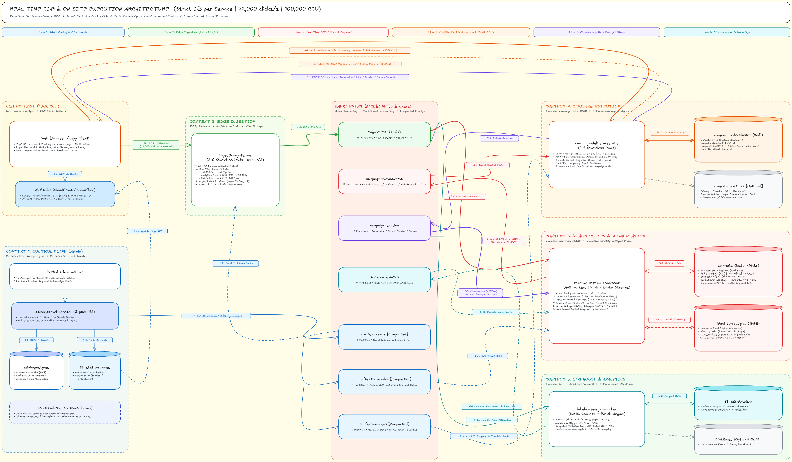

# Real-Time CDP & On-Site Execution Engine (Solution Hub)

Architecture governance, business specifications, and Polyrepo workspace hub for a high-throughput **Real-Time Customer Data Platform** (`> 2,000 clicks/s` sustained, `10,000 clicks/s` burst, `100,000 Concurrent Users`).

## Polyrepo Topology

Each runtime boundary lives in its own isolated Git repository with zero toolchain mixing:

| Repository | Tech Stack | Responsibility |
| :--- | :--- | :--- |
| **[`cdp-backend`](https://github.com/hocdotnet123-web/cdp-backend)** | Java 21 (Virtual Threads), Spring Boot 3.4, Gradle Kotlin DSL | 5 isolated microservices (`admin-portal-service`, `ingestion-gateway`, `realtime-stream-processor`, `campaign-delivery-service`, `lakehouse-sync-worker`) + zero-DB shared libs (`cdp-contracts`, `cdp-kafka-cache`). |
| **[`cdp-admin-portal`](https://github.com/hocdotnet123-web/cdp-admin-portal)** | React 19, TypeScript, Vite (`pnpm`) | Control Plane UI for managing Tag Containers, versioned Event Schemas, Streaming Rules, Segments, and Campaigns. |
| **[`cdp-web-sdk`](https://github.com/hocdotnet123-web/cdp-web-sdk)** | Zero-dependency Vanilla TypeScript (`< 15 KB` gzipped) | Browser Edge `TagSDK` (`/v1/collect`) & `PopupSDK` (`/v1/decide`, `/v1/reactions`) with enforced gzip size gate. |

## Architecture & Planning Artifacts

- **[docs/realtime_cdp_business_spec.md](./docs/realtime_cdp_business_spec.md)** — End-to-end Real-Time Processing Business Specification (Edge Ingestion & Consent Gate, Identity Resolution & Session Stitching, Sliding Windows, CEP Timers, Dynamic Segmentation, On-Site Arbitration & Multi-Tab Lua Lock, and `< 250ms` Closed-Loop Reaction).
- **[docs/cdp_strict_microservice_db_architecture.md](./docs/cdp_strict_microservice_db_architecture.md)** — Strict `1-to-1` Database-per-Service Architecture, Kafka Log-Compacted Config Topics, Event-Carried State Transfer, and HA sizing.
- **[tasks/plan.md](./tasks/plan.md)** — Sprint 0 roadmap & Linear issue dependency graph across the Polyrepo boundaries.
- **[realtime_cdp_strict_architecture.excalidraw](./realtime_cdp_strict_architecture.excalidraw)** — Editable Excalidraw architecture source diagram.
- **[AGENTS.md](./AGENTS.md)** — Always-on engineering, Polyrepo & DB isolation, and hot-path performance guardrails.
