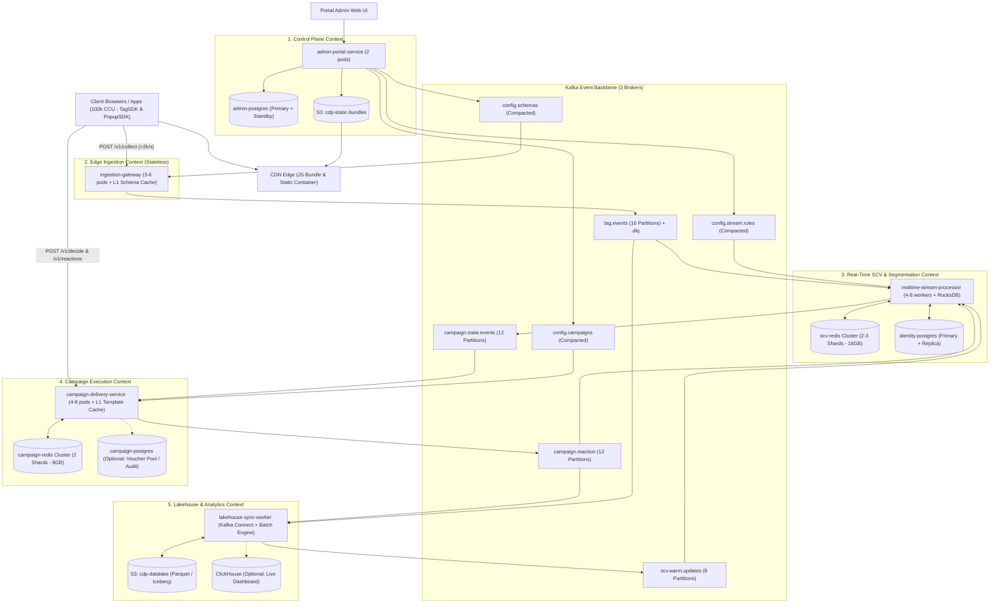

# Technical Architecture: Strict Database-per-Service Real-Time CDP
*(Target Load: `> 2,000 clicks/s` sustained, `10,000 clicks/s` peak burst, `100,000 Concurrent Users`)*

> [!IMPORTANT]
> **Strict Isolation Guarantee:** Không có bất kỳ 2 microservices nào kết nối chung vào một cụm `PostgreSQL`, một cụm `Redis`, hay một bucket `S3`. Mọi service sở hữu độc quyền (**1-to-1 Exclusive Ownership**) database và cache riêng của mình; toàn bộ dữ liệu liên thông giữa các bounded contexts được truyền bất đồng bộ qua **Kafka** bằng hai kỹ thuật: **Log-Compacted Config Topics** và **Event-Carried State Transfer**.

---

## 1. Sơ đồ Kiến trúc Bounded Contexts (100% Isolated DB & Redis)

---

## 2. Phân tách Microservices & Private Databases (1-to-1 Ownership)

| Microservice | Private Redis (Độc quyền) | Private DB / Storage (Độc quyền) | Dữ liệu nắm giữ & Vai trò |
| :--- | :--- | :--- | :--- |
| **`admin-portal-service`** | *Không cần* | **`admin-postgres`** (`2 vCPU, 8 GB RAM`) + **`S3 (static-bundles)`** | Source of Truth của Tag configs, Event Schemas, Feature/Segment Rules, Campaign Defs, UI Templates. |
| **`ingestion-gateway`** | *Không cần (100% Stateless)* | *Chỉ dùng L1 RAM Cache (`~100 MB`)* | Nhận `> 2,000 clicks/s`, validate Schema trên RAM, lọc **Consent Gate**, batch-produce vào `tag.events`. |
| **`realtime-stream-processor`** | **`scv-redis`** (`2–3 Masters + Replicas`, **`16 GB RAM`**) | **`identity-postgres`** (`4 vCPU, 16 GB RAM`) + **RocksDB** | Quản lý `dedup:evt`, `id:map`, `scv:session`, `scv:hot`, `seg:members`, bảng `identity_links` và `warm_profiles`. |
| **`campaign-delivery-service`** | **`campaign-redis`** (`2 Masters + Replicas`, **`8 GB RAM`**) | **L1 RAM Cache** + *(Optional)* **`campaign-postgres`** (`2 vCPU, 8 GB`) | Quản lý `camp:alias`, `camp:ustate`, Frequency Cap, Cooldown, Multi-tab Lua Lock (và kho mã Voucher độc nhất trên `campaign-postgres` nếu có). |
| **`lakehouse-sync-worker`** | *Không cần* | **`S3 (cdp-datalake)`** + *(Optional)* **`ClickHouse`** | Ghi file Parquet định kỳ `1–5 phút`, chạy batch tổng hợp lịch sử dài hạn và cung cấp số liệu báo cáo. |

---

## 3. Giải quyết 3 Bài toán Liên thông Dữ liệu khi Không Chung DB/Redis

Khi tách rời hoàn toàn cả `PostgreSQL` lẫn `Redis`, có 3 luồng dữ liệu trước đây đọc chéo DB nay được thay thế bằng cơ chế chuẩn **Event-Driven**:

### 3.1. Nạp Cấu hình lúc Pod Startup mà không gọi `admin-postgres`
- Thay vì để `ingestion-gateway`, `realtime-stream`, `campaign-delivery` query SQL vào `admin-postgres`, hệ thống tách thành **3 Kafka Compacted Topics** (`cleanup.policy = compact`, `1 partition` mỗi topic):
  1. `config.schemas` (Key = `schema_name`) ➔ chỉ `ingestion-gateway` đọc.
  2. `config.stream.rules` (Key = `rule_id`) ➔ chỉ `realtime-stream-processor` đọc.
  3. `config.campaigns` (Key = `campaign_id`, chứa cả Campaign Def + HTML/JSON Template) ➔ chỉ `campaign-delivery-service` đọc.
- **Cơ chế hoạt động:** Kafka tự động giữ lại bản ghi mới nhất cho từng Key (xóa campaign thì bắn tombstone `value = null`). Khi một pod mới autoscale lên, nó đọc topic của mình từ `offset = 0` mất chưa tới `500ms` là đầy đủ 100% L1 Cache — dù `admin-postgres` đang bảo trì thì tầng serving vẫn scale bình thường.

### 3.2. `campaign-delivery-service` Render & Check Identity/Consent mà không chạm `scv-redis`
Vì `campaign-delivery-service` chỉ được phép đọc **`campaign-redis`** của riêng nó, `realtime-stream-processor` truyền trạng thái sang qua topic **`campaign.state.events`** theo mô hình **Event-Carried State Transfer**:

| Event Type trên `campaign.state.events` | Khi nào `realtime-stream` bắn? | Hành động của `campaign-delivery` trên `campaign-redis` |
| :--- | :--- | :--- |
| **`CAMPAIGN_ENTER`** | User vừa thỏa mãn Segment của chiến dịch | Lưu `camp:alias:{cookie_id} -> MP_id`, khởi tạo state `READY` trong `camp:ustate:{MP_id}`, kèm snapshot `render_vars` (VD: `cart_value`, `tier`, `last_category`). |
| **`CONTEXT_UPDATED`** | User **đang có active campaign** mà thay đổi biến động dùng trong Template (VD: `current_cart_value` đổi) | Cập nhật nhanh trường `render_vars` trong `camp:ustate:{MP_id}` để Sticky Bar / Popup hiển thị số tiền chính xác nhất. |
| **`CAMPAIGN_EXIT`** | User vừa mua hàng xong hoặc hết thỏa mãn Segment | Xóa/revoke ngay campaign đó khỏi `camp:ustate:{MP_id}`. |
| **`IDENTITY_MERGED`** | `anon_01` vừa login và stitch vào `MP_99` | Trỏ `camp:alias:{anon_01} -> MP_99`, gộp lịch sử impression/cap của `anon_01` vào `camp:ustate:{MP_99}` để không bật trùng Popup. |
| **`CONSENT_REVOKED`** | User chuyển `personalization` sang `false` | Đặt cờ `consent_blocked = true` và purge toàn bộ active personalized campaigns trong `camp:ustate:{MP_99}`. |

> [!TIP]
> **Lợi ích lớn nhất về Fault Isolation:** Nếu `realtime-stream-processor` hoặc `scv-redis` gặp sự cố hay lag vài giây, toàn bộ `100,000 CCU` đang gọi `/v1/decide` vào `campaign-delivery-service` + `campaign-redis` **không bị ảnh hưởng bất kỳ mili-giây latency nào**, các chiến dịch đã kích hoạt vẫn hiển thị và giữ khóa đa tab chính xác 100%.

### 3.3. Đồng bộ *Warm Attributes* từ `S3` mà không cho `lakehouse-sync` ghi vào `identity-postgres` / `scv-redis`
- `lakehouse-sync-worker` sau khi tính xong các chỉ số lịch sử (chi tiêu 6 tháng, hạng thành viên...) trên `S3` sẽ **không mở kết nối DB sang `identity-postgres` hay `scv-redis`**.
- Thay vào đó, nó publish kết quả vào topic **`scv.warm.updates`**.
- `realtime-stream-processor` consume `scv.warm.updates` với tốc độ có kiểm soát (backpressure-aware), tự upsert vào bảng `warm_profiles` trên **`identity-postgres`** của nó, và chỉ cập nhật các keys đang `EXISTS` sẵn trên **`scv-redis`**.

---

## 4. Ma trận Kết nối Sau khi Tách Triệt để (Strict Isolation Matrix)

| Hạ tầng / Kafka Topic | `admin-portal` | `ingestion-gateway` | `realtime-stream` | `campaign-delivery` | `lakehouse-sync` |
| :--- | :--- | :--- | :--- | :--- | :--- |
| **`admin-postgres`** | **R / W (Exclusive)** | — | — | — | — |
| **`identity-postgres`** | — | — | **R / W (Exclusive)** | — | — |
| **`campaign-postgres`** *(Opt)* | — | — | — | **R / W (Exclusive)** | — |
| **`scv-redis` (`16 GB`)** | — | — | **R / W (Exclusive)** | — | — |
| **`campaign-redis` (`8 GB`)** | — | — | — | **R / W (Exclusive)** | — |
| **`S3: static-bundles` + `CDN`** | **WRITE (Exclusive)** | — | — | — | — |
| **`S3: cdp-datalake`** | — | — | — | — | **R / W (Exclusive)** |
| **`Kafka: config.schemas`** | **PRODUCE** | **CONSUME** | — | — | — |
| **`Kafka: config.stream.rules`** | **PRODUCE** | — | **CONSUME** | — | — |
| **`Kafka: config.campaigns`** | **PRODUCE** | — | — | **CONSUME** | — |
| **`Kafka: tag.events` (+ `.dlq`)** | — | **PRODUCE** | **CONSUME** *(Grp 1)* | — | **CONSUME** *(Grp 2)* |
| **`Kafka: campaign.state.events`** | — | — | **PRODUCE** | **CONSUME** | — |
| **`Kafka: campaign.reaction`** | — | — | **CONSUME** *(Grp 1)* | **PRODUCE** | **CONSUME** *(Grp 2)* |
| **`Kafka: scv.warm.updates`** | — | — | **CONSUME** | — | **PRODUCE** |

---

## 5. Tổng hợp Sizing Hạ tầng Tham chiếu (`> 2,000 clicks/s` & `100k CCU`)

| Hạng mục Hạ tầng | Cấu hình Đề xuất (Production HA) | Ghi chú Chịu tải |
| :--- | :--- | :--- |
| **`ingestion-gateway`** | `3 – 6 pods` × (`2 vCPU`, `2 GB RAM`) | Stateless, chịu được đỉnh `> 10,000 req/s`. |
| **`realtime-stream-processor`** | `4 – 8 instances` × (`4 vCPU`, `8 GB RAM`, NVMe cho RocksDB) | Scale theo `16 partitions` của `tag.events`. |
| **`campaign-delivery-service`** | `4 – 8 pods` × (`2 vCPU`, `4 GB RAM`) | L1 Template Cache giúp tải CPU rất nhẹ ở `100k CCU`. |
| **`admin-portal` & `lakehouse-sync`** | `2 pods` × (`2 vCPU`, `4 GB RAM`) mỗi service | Tách biệt hoàn toàn khỏi luồng real-time. |
| **`Kafka Cluster`** | `3 Brokers` × (`4 vCPU`, `16 GB RAM`, `500 GB NVMe`) | Băng thông thực tế `< 15 MB/s` kể cả lúc burst. |
| **`scv-redis` Cluster** | `2 hoặc 3 Masters + Replicas` (Tổng `16 GB RAM`) | Chứa Session (`100k`), Dedup, ID Cache, Hot SCV (`~3.5 GB` raw). |
| **`campaign-redis` Cluster** | `2 Masters + 2 Replicas` (Tổng `8 GB RAM`) | Chứa `camp:alias`, `camp:ustate` + chạy Atomic Lua Lock (`< 1.5 GB` raw). |
| **`admin-postgres`** | `1 Primary + 1 Standby` (`2 vCPU`, `8 GB RAM`, `100 GB SSD`) | Tải `< 20 QPS`, lưu metadata cấu hình. |
| **`identity-postgres`** | `1 Primary + 1 Replica` (`4 vCPU`, `16 GB RAM`, `500 GB NVMe`) | Chỉ chịu tải khi Cache Miss (On-Demand Hydration) & Async Batch Write. |
| **`campaign-postgres`** *(Optional)* | `1 Primary + 1 Standby` (`2 vCPU`, `8 GB RAM`, `100 GB SSD`) | Chỉ cần bật nếu có nghiệp vụ phát mã Voucher/Coupon độc nhất cho từng user. |
