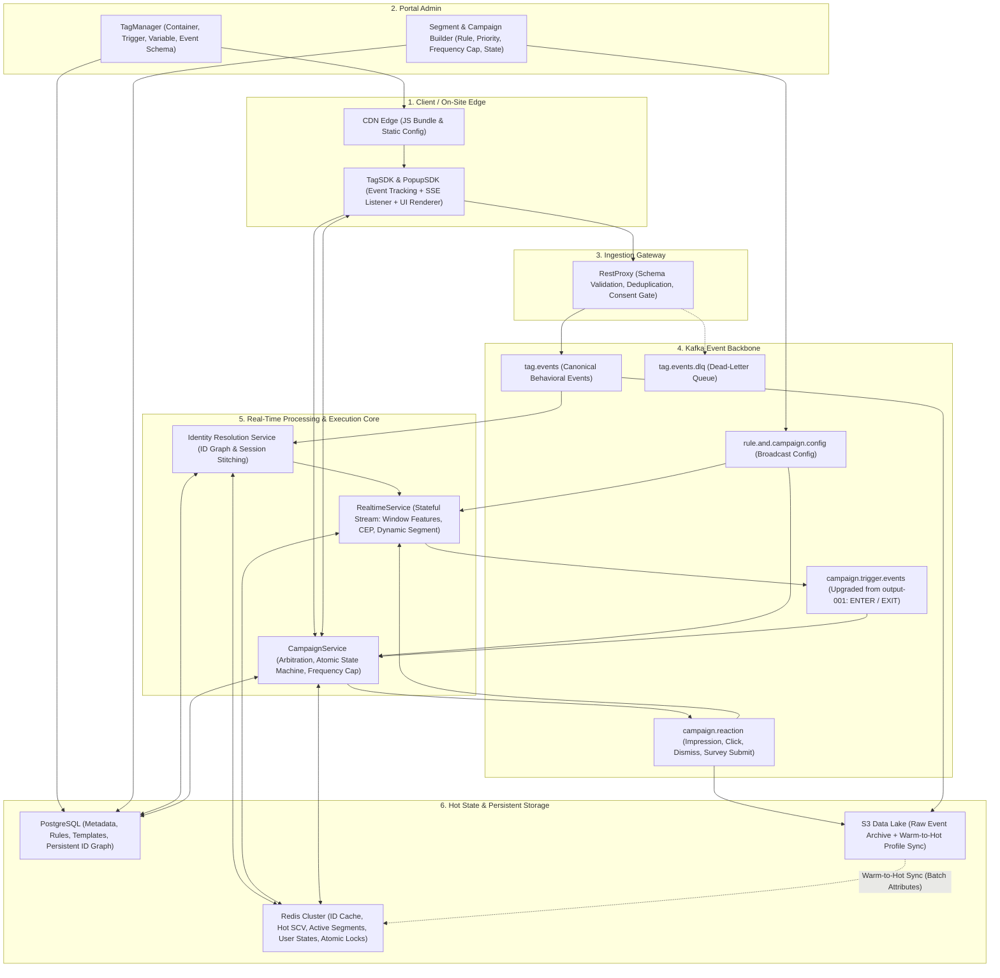
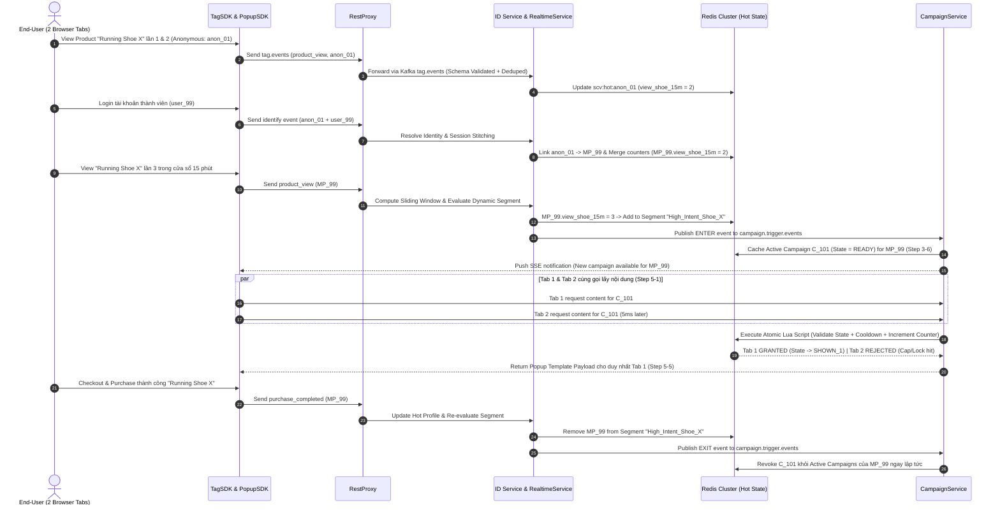
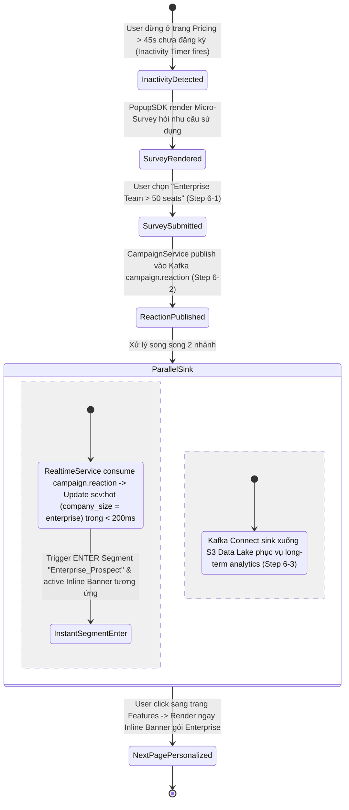

# Business Specification: Real-Time CDP & On-Site Execution Engine
*(Tập trung 100% vào Real-Time Stream Processing & On-Site Personalization ở độ trễ mili-giây)*

> [!IMPORTANT]
> **System Scope:** Loại bỏ hoàn toàn phần tích hợp AI và các Outbound Channels. Hệ thống tập trung chuyên sâu vào **Real-Time Stream Processing** ở độ trễ mili-giây: từ **Edge Ingestion** → **Session Stitching** → tính toán **Sliding Window Features & CEP** → đánh giá **Dynamic Segmentation** → **Campaign Arbitration & State Machine** cho On-Site UI (Popup, Sticky Bar, Inline Banner, Micro-Survey) → khép kín **Closed-Loop Reaction**.

---

## 1. Current Gaps & Target Real-Time SLAs

### 1.1. Các khoảng trống về Real-Time trong `BBB.excalidraw` cần giải quyết
1. **Thiếu Real-Time Identity Resolution & Session Stitching:** Khi user lướt web ở trạng thái anonymous rồi login, hành vi trước và sau login bị tách thành 2 profile rời rạc.
2. **Chưa có Streaming Customer Features & CEP:** `RealtimeService` mới chỉ đối chiếu từng event đơn lẻ với static segment trong `Redis`, chưa tính được **Sliding Window** hoặc chuỗi hành vi (**Complex Event Processing - CEP**) như *"View cùng 1 category ≥ 3 lần trong 10 phút nhưng chưa `add_to_cart`"*.
3. **Thiếu Real-Time Segment Exit & Campaign Revocation:** Mới chỉ có luồng ghi active campaign vào `Redis` (`3-6`) hoặc xóa khi Admin cập nhật campaign (`2-5`), chưa tự động revoke active campaign ngay giây user hoàn tất `purchase` hoặc không còn thỏa điều kiện segment.
4. **Pull Latency & Multi-Tab Race Condition:** Bước `4-1` phụ thuộc vào việc SDK tự poll server; chưa có cơ chế **Campaign Arbitration** khi user thỏa mãn nhiều campaign cùng lúc, và chưa có **Atomic Lock** chống bật trùng Popup khi user mở nhiều browser tabs song song.
5. **Đứt gãy Closed-Loop Reaction (`campaign.reaction`):** Ở bước `6-3`, dữ liệu tương tác của user với Popup/Survey chỉ sink một chiều xuống `S3` mà chưa loop ngược lại `RealtimeService` để cập nhật **Hot Profile** trên `Redis` ngay trong session.

### 1.2. Target Real-Time SLAs
| SLA Metric | Target (p95) | Ý nghĩa nghiệp vụ trên trải nghiệm End-User |
| :--- | :--- | :--- |
| **Event-to-Segment Latency** | `< 200 ms` | Từ lúc user thao tác trên web đến khi `RealtimeService` cập nhật xong Streaming Features & Segment trên `Redis`. |
| **Trigger-to-Display Latency** | `< 300 ms` | Từ lúc match điều kiện trigger đến khi Popup / Banner / Micro-Survey render trên màn hình user. |
| **Session Stitching Latency** | `< 150 ms` | Merge xong toàn bộ session history của `anonymous_id` vào `master_profile_id` ngay sau event Login / Identify. |
| **Reaction-to-Profile Loop** | `< 250 ms` | User vừa submit Micro-Survey ở trang A, click sang trang B đã thấy ngay nội dung cá nhân hóa theo câu trả lời đó. |

---

## 2. End-to-End Real-Time Architecture

---

## 3. Chi tiết 6 Modules Nghiệp vụ Real-Time

### Module 1: Edge Ingestion, Schema Validation, Deduplication & Consent Gate
*Nâng cấp Flow 1 (`TagManager` → `TagSDK` → `RestProxy` → `tag.events`).*

- **Canonical Event Schema & DLQ Routing:**
  - Mọi event từ Web `TagSDK`, Mobile SDK hoặc Server-to-Server Webhook (VD: `payment_succeeded`) đều chuẩn hóa theo một envelope thống nhất: `event_id` (client-generated UUID), `event_name`, `event_timestamp` (client time), `received_timestamp` (gateway time), khối identifiers (`anonymous_id`, `user_id`, `session_id`) và `properties`.
  - Quản lý Schema Versioning ngay trên `Portal Admin (TagManager)`. Event sai schema hoặc thiếu trường bắt buộc được route thẳng sang `tag.events.dlq` để alert & replay sau, tránh làm crash/stall pipeline chính.
- **Real-Time Event Deduplication (Idempotency):**
  - Khi kết nối mạng không ổn định, SDK retry có thể gửi trùng payload. Gateway hoặc bước đầu của `RealtimeService` kiểm tra `event_id` trên `Redis` (short TTL ~10 phút) để drop các bản tin duplicate trước khi cộng vào bộ đếm hành vi.
- **Real-Time Consent Gate:**
  - **Nguồn dữ liệu Consent:** Khi user tương tác với Cookie/Privacy Banner trên web, `TagSDK` lưu lựa chọn theo từng nhóm quyền độc lập (`analytics`, `personalization`) và đính kèm object `consent_flags` vào envelope của **mọi event** gửi lên `RestProxy`, đồng thời bắn event `consent_updated` ngay khi user thay đổi quyền.
  - **Routing Matrix ngay tại biên (`RestProxy` / Stream Entry):**
    1. **Full Opt-in (`analytics = true`, `personalization = true`):** Cho phép đi qua toàn bộ pipeline — vừa sink raw event xuống `S3`, vừa đẩy vào `Identity Resolution` → `RealtimeService` → cập nhật `Redis` SCV và kích hoạt On-Site Campaign.
    2. **Analytics Only (`analytics = true`, `personalization = false`):** Strip/hash các trường PII định danh trực tiếp (`user_id`, `email`, `phone`) trước khi sink xuống `S3` để vẫn thống kê được traffic/pageview tổng thể; đồng thời **drop/bypass khỏi luồng `RealtimeService` & `Redis` SCV** (user chỉ thấy các thông báo broadcast chung, không bị tracking profile hay bật Popup bám đuổi cá nhân hóa).
    3. **Full Opt-out (`analytics = false`, `personalization = false`):** `TagSDK` dừng gửi behavioral events từ phía client; nếu có request lọt lên `RestProxy`, gateway trả HTTP `204` và drop ngay tại biên, không publish vào Kafka.
  - **Mid-Session Consent Revocation:** Nếu user đang dùng web mà chuyển `personalization` từ `true ➔ false`, event `consent_updated` lập tức đánh dấu cờ opt-out trong `Redis` và **purge toàn bộ `camp:ustate` (active personalized campaigns)** đang chờ của user đó ngay trong phiên.

---

### Module 2: Real-Time Identity Resolution & Session Stitching
*Hiện thực hóa năng lực Single Customer View (SCV) hợp nhất ngay trên luồng streaming.*

- **High-Speed `master_profile_id` Lookup:**
  - Mọi event đi qua `Identity Resolution Service` đều được resolve từ các định danh thành phần (`cookie_id`, `device_id`, `user_id`, `phone_hash`, `email_hash`) về một khóa gốc duy nhất là **`master_profile_id`** (lookup trên `Redis` ID Cache, fallback xuống `PostgreSQL` Identity Graph khi cache miss).
- **Anonymous-to-Known Session Stitching:**
  - **Tình huống:** User mới vào web với `anon_123` → xem 4 sản phẩm → login vào tài khoản `user_999` (đã thuộc về `master_profile_id = MP_888`).
  - **Luồng xử lý tức thời (< 150ms):**
    1. Cập nhật mapping `anon_123 -> MP_888` vào Identity Graph (`PostgreSQL` + `Redis`).
    2. **Hot State Merge:** Gộp toàn bộ session counters & sliding window metrics đang tích lũy của `anon_123` sang **Hot Profile** của `MP_888` trên `Redis`.
    3. **State & Frequency Cap Inheritance:** Chuyển lịch sử impression/dismiss trong session của `anon_123` sang `MP_888` để user không bị hiển thị lại đúng Popup vừa đóng trước khi login.
    4. Trigger re-evaluation ngay lập tức cho `MP_888` dựa trên profile vừa merge.
- **Account Switching & ID Rotation:**
  - Khi phát hiện event `logout` hoặc login bằng một `user_id` khác với `user_id` trước đó trên cùng trình duyệt, `TagSDK` tự động **rotate** sinh `anonymous_id` và `session_id` mới để không trộn lẫn dữ liệu giữa hai người dùng chung thiết bị.

---

### Module 3: Streaming Customer Features & Complex Event Processing (CEP)
*Hiện thực hóa tính năng No-Code `Customer Feature` ở chế độ Real-Time.*

Thay vì hardcode logic trong `RealtimeService`, Marketer định nghĩa các **Streaming Features** trên `Portal Admin` để engine tự động tính toán liên tục trên luồng sự kiện:

1. **Session-Scoped Features (Thuộc tính trong phạm vi phiên truy cập):**
   - **Cơ chế Session Lifecycle:** Một `session` đại diện cho 1 lần ghé thăm liên tục của user (định danh bởi `session_id`, tự động hết hạn và tạo session mới sau **30 phút không có tương tác** — `30m sliding inactivity TTL`). Khác với *Warm Attributes* (lịch sử dài hạn) hay *Sliding Window* (trượt cố định theo phút bất kể phiên), nhóm này phản ánh **ý định & ngữ cảnh của riêng lần ghé thăm hiện tại** và được chia làm 3 loại:
     - **First-Touch Session Context (Ghi 1 lần đầu phiên - Immutable trong suốt session):** Lưu `landing_page`, `referrer`, `utm_source`, `utm_medium`, `utm_campaign`, `device_type`. *Ý nghĩa:* Khi user click từ quảng cáo (`?utm_campaign=payday_sale`) vào trang chủ rồi bấm sang 5 trang sản phẩm kế tiếp, URL trình duyệt không còn tham số `utm_*` nữa; nhờ giữ biến này suốt session, ở trang thứ 5 hệ thống vẫn biết user đến từ campaign *Payday Sale* để bật đúng Popup ưu đãi tương ứng.
     - **Cumulative Session Counters (Cộng dồn liên tục từ đầu phiên):** Gồm `session_page_views`, `session_product_views`, `session_search_count`, `session_dwell_time` (`latest_event_ts - session_start_ts`). *Ý nghĩa:* Đo mức độ quan tâm thực sự trong phiên (VD: chỉ trigger Popup tư vấn hoặc Micro-Survey khi `session_page_views >= 4` VÀ `session_dwell_time >= 90s`, tránh làm phiền user vừa mới vào trang).
     - **Latest-State Pointers (Ghi đè theo trạng thái mới nhất trong phiên):** Gồm `current_url`, `last_viewed_product_id`, `last_viewed_category`, `last_search_keyword`, `current_cart_value`, `current_cart_item_count`. *Ý nghĩa:* Vừa dùng làm điều kiện segment tức thời, vừa dùng để **Dynamic Variable Injection** vào UI Template ở bước `5-3` (VD: hiển thị Sticky Bar *"Mua thêm `150.000đ` để được Freeship"* tính trực tiếp từ `freeship_threshold - current_cart_value`).
2. **Sliding & Tumbling Window Aggregations:**
   - Hỗ trợ các hàm `COUNT`, `SUM`, `AVG`, `MIN/MAX`, `DISTINCT_COUNT` trên cửa sổ trượt thời gian thực (1m, 5m, 15m, 1h, 24h).
   - *Ví dụ:* *"Số lần view cùng một `product_id` trong 15 phút qua"*, *"Số lần apply voucher bị lỗi trong 5 phút qua"*, *"Số lượng category khác nhau đã xem trong 30 phút"*.
3. **Sequence CEP & Inactivity Timers:**
   - Nhận diện chuỗi sự kiện theo thứ tự thời gian kèm điều kiện timeout: **`add_to_cart` → `begin_checkout` → KHÔNG xuất hiện `purchase_completed` trong vòng 3 phút**.
   - `RealtimeService` tự động đăng ký **Stateful Inactivity Timer**; khi hết 3 phút mà chưa có event hoàn tất đơn, engine tự emit internal event `checkout_stalled_3m` để kích hoạt Popup hỗ trợ hoặc ưu đãi ngay khi user vẫn còn trên trang.
4. **Hybrid SCV Profile (Hot + Warm Attributes):**
   - Mỗi profile trên `Redis` kết hợp 2 lớp thuộc tính:
     - **Warm Attributes** (sync định kỳ từ `S3` Data Lake): Membership tier, tổng chi tiêu 6 tháng, `days_since_last_purchase`, favorite category lịch sử.
     - **Hot Attributes** (cập nhật từng mili-giây bởi `RealtimeService`): Session metrics, Sliding Window counters và dữ liệu Micro-Survey vừa thu thập.

---

### Module 4: Real-Time Dynamic Segmentation (Entry & Exit Lifecycle)
*Nâng cấp toàn diện bước `3-2` & `3-3` trong diagram hiện tại.*

- **Streaming Rule Evaluation:**
  - Ngay sau khi `Hot Attributes` của `master_profile_id` thay đổi, `RealtimeService` đánh giá lại Rule Tree của các active segments (kết hợp cả *Warm* và *Hot Attributes*).
- **Segment Membership Lifecycle (`ENTER` / `EXIT` Transitions):**
  - Thay vì chỉ bắn message một chiều như `output-001` cũ, hệ thống quản lý trạng thái membership của user đối với từng segment trên `Redis`:
    - `False ➔ True` (**Segment `ENTER`**): Publish event `ENTER` vào `campaign.trigger.events` để `CampaignService` khởi tạo active campaign cho user.
    - `True ➔ False` (**Segment `EXIT` / Disqualified**): Publish event `EXIT` vào `campaign.trigger.events`. Ví dụ ngay giây user hoàn tất thanh toán (`cart_item_count = 0`), user lập tức `EXIT` khỏi segment *"Abandoned Cart Risk"* → `CampaignService` **revoke ngay các active campaigns nhắc giỏ hàng** của user đó trên `Redis`.
- **Zero-Downtime Rule Broadcast:**
  - Khi Marketer publish hoặc cập nhật rule phân khúc trên `Portal Admin`, cấu hình được đẩy qua broadcast topic `rule.and.campaign.config` tới toàn bộ instances của `RealtimeService` để hot-reload mà không cần restart hay làm gián đoạn luồng streaming.

---

### Module 5: On-Site Campaign State Machine, Arbitration & Frequency Capping
*Nâng cấp sâu `CampaignService`, `PopupSDK` và State Machine trên `Redis` (Flows 2, 4, 5).*

- **Multi-Format On-Site Rendering:**
  - Mở rộng `PopupSDK` thành **On-Site Rendering SDK**, hỗ trợ đa dạng format hiển thị: **Modal Popup**, **Slide-in / Toast**, **Top/Bottom Sticky Bar**, **Inline Embedded Banner** (mount vào DOM selector cụ thể trên web), và **Contextual Micro-Survey**.
- **Hybrid Push (SSE / Piggyback) + Pull Delivery:**
  - Khắc phục độ trễ bước `3-6` → `4-1`: ngoài việc fetch active campaigns khi chuyển trang, SDK hỗ trợ nhận thông báo tức thời qua **Server-Sent Events (SSE)** (hoặc nhận flag piggyback ngay trong HTTP response của request gửi event) để render Popup/Survey ngay giữa phiên khi Inactivity Timer hoặc Exit Intent vừa nổ.
- **Real-Time Campaign Arbitration (Phân xử xung đột chiến dịch):**
  - Khi một user đồng thời đủ điều kiện nhận nhiều chiến dịch trên cùng một trang, `CampaignService` phân xử qua 3 bước lọc:
    1. Kiểm tra **Schedule, Valid URL/Domain pattern, Device targeting**.
    2. Lọc theo **Mutual Exclusion Group** (VD: user đang thấy chiến dịch Flash Sale thì suppress toàn bộ chiến dịch Survey thông thường).
    3. Xếp hạng theo **Priority Score** để đảm bảo mỗi **Display Slot** chỉ trả về duy nhất **1 winning campaign**.
- **Atomic State Machine & Multi-Tab Race Condition Prevention:**
  - Xử lý triệt để trường hợp user mở 3–5 browser tabs cùng lúc. Ở bước `5-2` → `5-4` (validate state & update counters), `CampaignService` chạy **Atomic Lua Script trên `Redis`**: nếu Tab 1 vừa claim quyền hiển thị một Popup có rule *"Max 1 impression/session"*, request gửi lên chậm hơn vài mili-giây từ Tab 2 sẽ bị reject ngay lập tức.
- **Multi-Tier Frequency Capping & Cooldown:**
  - **Campaign-level Cap:** Giới hạn tối đa `N` impressions/user/day hoặc lifetime; dừng vĩnh viễn khi user bấm *"Don't show again"* hoặc đạt Conversion Goal.
  - **Session-level Cap:** Giới hạn tối đa `M` Modal Popups trong cùng 1 session.
  - **Global Cap & Cooldown:** Bắt buộc khoảng nghỉ tối thiểu (**Cooldown**, VD: 10 phút) giữa 2 lần hiển thị Popup bất kỳ để chống spam giao diện.

---

### Module 6: Closed-Loop Reaction & Warm-to-Hot Profile Sync
*Khép kín hoàn toàn Flow 6 (`6-1` → `6-3`).*

- **Sub-Second Closed-Loop Reaction (`campaign.reaction` ➔ `RealtimeService`):**
  - Mọi tương tác của user với template trên `PopupSDK` (`impression`, `click_cta`, `dismiss`, `coupon_copied`, `survey_submitted`) được publish vào Kafka topic `campaign.reaction`.
  - Khác với diagram gốc chỉ sink xuống `S3`, **`RealtimeService` subscribe trực tiếp `campaign.reaction`** để cập nhật ngay câu trả lời Survey hoặc phản ứng của user vào **Hot Attributes** trên `Redis` (`< 250ms`), cho phép re-segment tức thời ngay ở lần chuyển trang kế tiếp.
- **Warm-to-Hot Sync & On-Demand Profile Hydration (`S3` ↔ `Redis`):**
  - Toàn bộ `tag.events` và `campaign.reaction` tiếp tục được sink xuống `S3` Data Lake (Parquet/Iceberg partitioned theo giờ).
  - Các batch/micro-batch jobs tổng hợp dữ liệu lịch sử trên `S3` để cập nhật lớp **Warm Attributes** ngược lên `Redis`. Để tối ưu RAM khi tập khách hàng lớn, `Redis` áp dụng **Sliding TTL** cho active users và hỗ trợ **On-Demand Hydration** (nạp nhanh Warm Profile từ persistent store lên `Redis` ngay khi user bắt đầu session mới).

---

## 4. Thiết kế Hot State trên `Redis` (Reference Schema)

| Redis Key Pattern | Data Type | Mục đích & Payload Lưu trữ | TTL Strategy |
| :--- | :--- | :--- | :--- |
| `id:map:{id_type}:{value}` | `String` | Resolve nhanh `cookie_id`, `user_id`, `phone_hash` về `master_profile_id`. | LRU Cache / Session TTL |
| `dedup:evt:{event_id}` | `String` | Chống xử lý trùng event khi SDK retry. | Fixed TTL `10m` |
| `scv:session:{session_id}` | `Hash` | Lưu **Session-Scoped Features** (`utm_*` đầu phiên, `session_page_views`, `session_dwell_time`, `last_viewed_product_id`, `current_cart_value`). | Sliding TTL `30m` |
| `scv:hot:{master_profile_id}` | `Hash` | Lưu **Warm Attributes** + **Hot Attributes** (sliding counters, survey answers, consent flags). | Sliding TTL `7d–30d` |
| `seg:members:{master_profile_id}` | `Set` | Danh sách `segment_id` hiện tại của user (dùng để detect transition `ENTER` / `EXIT`). | Theo vòng đời Profile |
| `camp:def:{campaign_id}` | `Hash / JSON` | Cấu hình campaign (schedule, URL rules, priority, exclusion group, capping, state transitions). | Evict/Update khi kết thúc hoặc sửa (`2-5`) |
| `camp:ustate:{master_profile_id}` | `Hash` | Active campaigns của user, current state step, impression counters, `last_shown_at` (cho Cooldown & Atomic Lua Lock). | Theo `end_time` của Campaign |

---

## 5. End-to-End Real-Time Workflows

### 5.1. Flow A: Session Stitching + Sliding Window + Multi-Tab Atomic Lock + Real-Time Revocation

### 5.2. Flow B: Sub-Second Micro-Survey Closed-Loop (`< 250ms`)

---

## 6. Implementation Roadmap (Nâng cấp từ `BBB.excalidraw`)

1. **Phase 1 — On-Site Execution Hardening, Arbitration & Multi-Tab Lock:**
   - Bổ sung bước response `5-5` (`CampaignService` → `PopupSDK`), đưa JS Bundle lên CDN, thêm **Schema Validation + Event Deduplication + Consent Gate** tại `RestProxy`.
   - Nâng cấp `CampaignService` + `Redis` với **Atomic Lua State Machine** (chống race condition đa tab), **Campaign Arbitration** (*Priority* & *Mutual Exclusion*), và **Multi-Tier Frequency Capping / Cooldown**.
2. **Phase 2 — Closed-Loop Reaction & Stateful Stream Processing:**
   - Loop topic `campaign.reaction` quay ngược vào `RealtimeService` để dữ liệu tương tác Popup/Micro-Survey cập nhật thẳng vào **Hot Profile** trên `Redis`.
   - Nâng cấp `RealtimeService` hỗ trợ **Sliding Window Aggregations**, **Sequence CEP / Inactivity Timers** và quản lý lifecycle **Segment `ENTER` / `EXIT`** để tự động revoke chiến dịch ngay khi user vừa convert.
3. **Phase 3 — Real-Time Identity Resolution & Warm-to-Hot Sync:**
   - Triển khai `Identity Resolution Service` thực hiện **Anonymous-to-Known Session Stitching** (merge counters và kế thừa campaign state không đứt quãng).
   - Xây dựng pipeline **Warm-to-Hot Sync** từ `S3` Data Lake lên `Redis` kết hợp cơ chế **On-Demand Hydration** khi user bắt đầu session mới.
