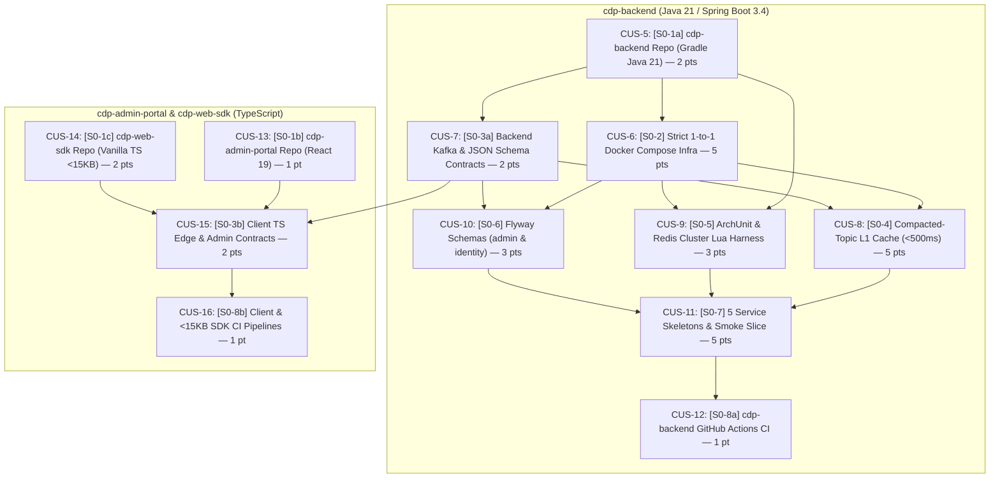

# Implementation Plan: Real-Time CDP & On-Site Execution Engine (Sprint 0 — Polyrepo)

> **Task List Target:** Tasks and dependencies are tracked in **Linear** under team `CUS` across 4 phased roadmap projects:
> - **[P-CUS-1: Phase 0 — Platform Foundation & Canonical Contracts (Sprint 0)](https://linear.app/customer-data-platform/project/phase-0-platform-foundation-and-canonical-contracts-sprint-0-6e2bf006cf76)** *(Active: `2026-11-04` -> `2026-11-18`)*
> - **[P-CUS-2: Phase 1 — Edge Ingestion, Arbitration & Multi-Tab Lock](https://linear.app/customer-data-platform/project/phase-1-edge-ingestion-arbitration-and-multi-tab-lock-71bc2ded74a3)** *(Planned: `2026-11-19` -> `2026-12-09`)*
> - **[P-CUS-3: Phase 2 — Stateful CEP, Dynamic Segments & Closed-Loop Reaction](https://linear.app/customer-data-platform/project/phase-2-stateful-cep-dynamic-segments-and-closed-loop-reaction-d9c88b4ec922)** *(Planned: `2026-12-10` -> `2026-12-30`)*
> - **[P-CUS-4: Phase 3 — Real-Time Identity Stitching & Lakehouse Warm Sync](https://linear.app/customer-data-platform/project/phase-3-real-time-identity-stitching-and-lakehouse-warm-sync-1ec0fdc93552)** *(Planned: `2026-12-31` -> `2027-01-20`)*
> - **Label Groups (`CUS`):** `Bounded Context` (`infra`, `contracts`, `admin-portal`, `ingestion-gateway`, `stream-processor`, `campaign-delivery`, `lakehouse-sync`, `client-sdk`), `Delivery Wave` (`sprint-0`), and `Work Type` (`Feature`, `Bug`, `Improvement`).

## Overview

Greenfield rebuild of the high-throughput **Real-Time CDP & On-Site Execution Engine** (`> 2,000 clicks/s` sustained, `10,000 clicks/s` peak burst, `100,000 CCU`) defined in `docs/lgcns_cdp_expanded_business_spec.md`, `docs/cdp_strict_microservice_db_architecture.md`, and `AGENTS.md`.

**Sprint 0 Goal:** Deliver strictly decoupled **Polyrepo** codebases (`cdp-backend`, `cdp-admin-portal`, `cdp-web-sdk`) backed by 1-to-1 isolated local infrastructure, canonical Kafka + JSON Schema contracts, `< 500 ms` compacted-topic L1 cache hydration, automated ArchUnit/Redis Cluster isolation guardrails, and per-repository green CI pipelines.

## Polyrepo Architecture & Stack Decisions

- **`cdp-backend` (Backend Git Repo):** Java 21 (Virtual Threads enabled) + Spring Boot 3.4 managed via a standalone Gradle Kotlin DSL multi-module build (`libs:cdp-contracts`, `libs:cdp-kafka-cache`, and 5 isolated `services:*` modules with zero cross-service imports).
- **`cdp-admin-portal` (Control Plane UI Git Repo):** Standalone React 19 + TypeScript + Vite (`pnpm`) repository completely decoupled from backend Gradle and Edge SDK toolchains.
- **`cdp-web-sdk` (Edge SDK Git Repo):** Standalone zero-dependency Vanilla TypeScript `TagSDK` & `PopupSDK` repository with an automated `< 15 KB` gzipped budget gate (`scripts/check-sdk-size.mjs`).
- **Stateful Stream Processing:** Apache Kafka + **Kafka Streams with RocksDB** inside `realtime-stream-processor` for bounded-memory Sliding/Tumbling Windows and CEP Inactivity Timers.
- **Hot-State & Multi-Tab Concurrency:** Two physically isolated **Redis Clusters** (`scv-redis` for `realtime-stream-processor`, `campaign-redis` for `campaign-delivery-service`) running in cluster mode locally so `{master_profile_id}` hash-tag rules and Atomic Lua State Machine scripts are validated against `CROSSSLOT` errors from day one.
- **Deferred Optional Stores:** Optional `ClickHouse` and `campaign-postgres` (unique voucher pool) are deferred out of Sprint 0 to keep the baseline surgical and lightweight.

## Sprint 0 Capacity & Dependency Graph

- **Duration:** 2 weeks (`2026-11-04` -> `2026-11-18`)
- **Estimated Capacity:** ~35 story points (with buffer reserved for infra tuning)
- **Committed Scope:** **32 story points** across **12 decoupled issues** (`CUS-5` – `CUS-16`)

## Task List (Linear Index)

### Wave 1: Polyrepo Foundation, Isolated Infra & Canonical Contracts
1. **[CUS-5](https://linear.app/customer-data-platform/issue/CUS-5/s0-1a-initialize-cdp-backend-repository-gradle-kotlin-dsl-java-21-and)** — `[S0-1a]` Initialize `cdp-backend` Repository (Gradle Kotlin DSL, Java 21 & Spring Boot 3.4) *(2 pts, Urgent)*
2. **[CUS-13](https://linear.app/customer-data-platform/issue/CUS-13/s0-1b-initialize-cdp-admin-portal-repository-react-19-typescript-and)** — `[S0-1b]` Initialize `cdp-admin-portal` Repository (React 19, TypeScript & Vite) *(1 pt, High)*
3. **[CUS-14](https://linear.app/customer-data-platform/issue/CUS-14/s0-1c-initialize-cdp-web-sdk-repository-zero-dependency-vanilla-ts-and)** — `[S0-1c]` Initialize `cdp-web-sdk` Repository (Zero-Dependency Vanilla TS & `<15KB` Budget Gate) *(2 pts, Urgent)*
4. **[CUS-6](https://linear.app/customer-data-platform/issue/CUS-6/s0-2-provision-strict-1-to-1-isolated-docker-compose-infra-postgres)** — `[S0-2]` Provision Strict 1-to-1 Isolated Docker Compose Infra (`cdp-backend/deploy/`) *(5 pts, Urgent — blocked by `CUS-5`)*
5. **[CUS-7](https://linear.app/customer-data-platform/issue/CUS-7/s0-3a-define-canonical-kafka-contracts-and-json-schemas-in-cdp-backend)** — `[S0-3a]` Define Canonical Kafka Contracts & JSON Schemas in `cdp-backend` (`libs:cdp-contracts`) *(2 pts, Urgent — blocked by `CUS-5`)*
6. **[CUS-15](https://linear.app/customer-data-platform/issue/CUS-15/s0-3b-define-canonical-typescript-edge-and-control-plane-contracts-cdp)** — `[S0-3b]` Define Canonical TypeScript Edge & Control-Plane Contracts (`cdp-web-sdk` & `cdp-admin-portal`) *(2 pts, High — blocked by `CUS-7`, `CUS-13`, `CUS-14`)*

#### Checkpoint 1 (After Wave 1)
- [ ] `cdp-backend`: `./gradlew clean check` passes independently
- [ ] `cdp-admin-portal`: `pnpm install && pnpm run build` passes independently
- [ ] `cdp-web-sdk`: `pnpm install && pnpm run build` passes with `< 15 KB` gzipped bundles
- [ ] `docker compose -f cdp-backend/deploy/docker-compose.yml up -d` boots healthy isolated Postgres, Redis Clusters (`cluster_state:ok`), MinIO buckets, and all 8 Kafka topics

### Wave 2: L1 Config Cache, Guardrails & Exclusive Schemas (`cdp-backend` — Parallelizable)
7. **[CUS-8](https://linear.app/customer-data-platform/issue/CUS-8/s0-4-build-reusable-kafka-compacted-topic-l1-in-memory-cache-loader)** — `[S0-4]` Build Reusable Kafka Compacted-Topic L1 In-Memory Cache Loader (`libs:cdp-kafka-cache`) *(5 pts, High — blocked by `CUS-6`, `CUS-7`)*
8. **[CUS-9](https://linear.app/customer-data-platform/issue/CUS-9/s0-5-enforce-bounded-context-isolation-archunit-and-redis-cluster-hash)** — `[S0-5]` Enforce Bounded-Context Isolation (ArchUnit) & Redis Cluster Hash-Tag Lua Harness *(3 pts, High — blocked by `CUS-5`, `CUS-6`)*
9. **[CUS-10](https://linear.app/customer-data-platform/issue/CUS-10/s0-6-author-baseline-flyway-schemas-for-exclusive-admin-postgres-and)** — `[S0-6]` Author Baseline Flyway Schemas for Exclusive `admin-postgres` & `identity-postgres` Stores *(3 pts, High — blocked by `CUS-6`, `CUS-7`)*

#### Checkpoint 2 (After `CUS-8` – `CUS-10`)
- [ ] Compacted-topic L1 cache hydrates 1,000 records in `< 500 ms` and gates Spring `ReadinessState`
- [ ] ArchUnit isolation suite and multi-key Redis Cluster Lua script (`{master_profile_id}`) pass with zero `CROSSSLOT` errors
- [ ] Flyway `V1` migrations pass independently against `admin-postgres` and `identity-postgres`

### Wave 3: Backend Service Skeletons & Smoke Slice (`cdp-backend`)
10. **[CUS-11](https://linear.app/customer-data-platform/issue/CUS-11/s0-7-bootstrap-5-isolated-spring-boot-service-skeletons-sla)** — `[S0-7]` Bootstrap 5 Isolated Spring Boot Service Skeletons, SLA Observability & Sprint 0 Smoke Slice *(5 pts, High — blocked by `CUS-8`, `CUS-9`, `CUS-10`)*

### Wave 4: Per-Repository CI Quality & `<15KB` SDK Budget Gates
11. **[CUS-12](https://linear.app/customer-data-platform/issue/CUS-12/s0-8a-configure-github-actions-ci-pipeline-for-cdp-backend-java-21)** — `[S0-8a]` Configure GitHub Actions CI Pipeline for `cdp-backend` (Java 21, ArchUnit & Testcontainers) *(1 pt, Medium — blocked by `CUS-11`)*
12. **[CUS-16](https://linear.app/customer-data-platform/issue/CUS-16/s0-8b-configure-github-actions-ci-pipelines-for-cdp-admin-portal-and)** — `[S0-8b]` Configure GitHub Actions CI Pipelines for `cdp-admin-portal` & `cdp-web-sdk` (`<15KB` Gate) *(1 pt, Medium — blocked by `CUS-15`)*

#### Checkpoint 3: Sprint 0 Complete
- [ ] All 5 Spring Boot skeletons in `cdp-backend` boot against their exclusive stores and expose Prometheus p95 SLA buckets
- [ ] End-to-end config publish -> compacted Kafka -> `< 500 ms` L1 gateway hydration smoke test passes
- [ ] Independent CI pipelines green across `cdp-backend`, `cdp-admin-portal`, and `cdp-web-sdk`; ready to decompose Phase 1 (`Sprint 1`) vertical slices

## Risks and Mitigations

| Risk | Impact | Mitigation |
| :--- | :--- | :--- |
| Cross-repo contract drift between `cdp-backend`, `cdp-admin-portal`, and `cdp-web-sdk` | Med | Publish versioned `v1` JSON Schemas in `cdp-backend` (`CUS-7`) and validate client TypeScript fixtures against those schemas (`CUS-15`). |
| Local Docker memory pressure running 2 Redis Clusters + Kafka + 2 Postgres + MinIO | Med | Use single-broker Redpanda / KRaft Kafka (`512 MB` heap) and minimal 3-master `redis-cluster` containers capped via Docker `mem_limit`; omit optional ClickHouse & `campaign-postgres` in Sprint 0. |
| Serving pod receives `/v1/collect` or `/v1/decide` before compacted Kafka config finishes loading | High | Gate Kubernetes/Actuator `ReadinessState.ACCEPTING_TRAFFIC` in `CompactedTopicCache` (`CUS-8`) until initial `endOffsets` watermark is reached (`< 500 ms`). |
| Accidental cross-slot Lua failure on `campaign-redis` or `scv-redis` | High | Enforce `RedisClusterKeys` (`{master_profile_id}` hash tags) and test against real Redis Cluster topology in `CUS-9`, never standalone Redis. |
| Gradual erosion of 1-to-1 DB/Redis isolation across PRs | High | Fail builds automatically via ArchUnit dependency & package rules in `CUS-9` and `cdp-backend` GitHub Actions CI in `CUS-12`. |
